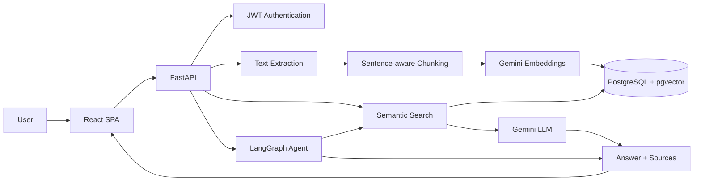
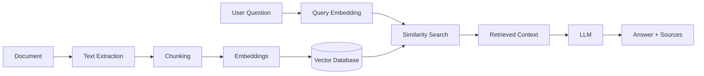
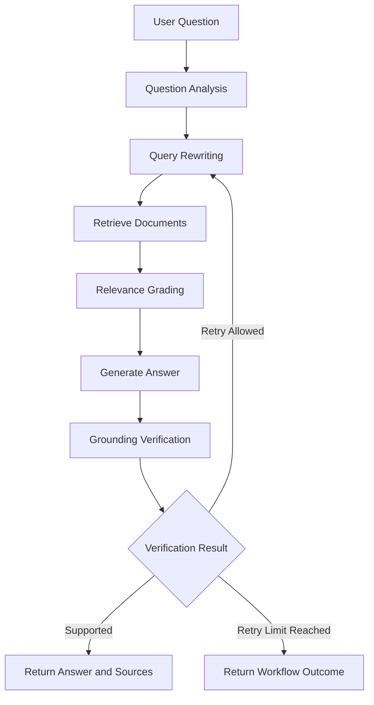

# DocMind AI


**AI-powered document assistant built with Retrieval-Augmented Generation (RAG) and agentic workflows.**

DocMind AI enables users to upload documents, ask questions in natural
language, and receive AI-generated answers grounded in their own knowledge base.

The system combines semantic search, LLM-based reasoning, source attribution,
and LangGraph workflows to improve the relevance and reliability of responses.

The project covers the complete AI application lifecycle: document processing,
retrieval, answer generation, evaluation, backend development, frontend
integration, cloud deployment, and security.

## Demo

### Document Question Answering

Upload documents and ask questions. The system retrieves relevant passages
and generates answers with references to the original sources.


### Agentic RAG

Inspect the agent's execution trace, including query analysis, retrieval,
relevance grading, answer generation, and grounding verification.


<details>
<summary>More screenshots</summary>

### Document Management


### REST API Documentation


</details>

## Features

- **Document Processing** — PDF, DOCX and TXT support, text extraction,
  sentence-aware chunking, file validation and deduplication.
- **Semantic Search** — vector embeddings and similarity search using pgvector.
- **Standard RAG** — document-grounded question answering with source references.
- **Agentic RAG** — LangGraph workflow with query rewriting, relevance grading,
  grounding verification and bounded retries.
- **Agent Trace** — visibility into individual stages of agent execution.
- **Authentication** — JWT-based authentication and per-user document isolation.
- **Document Management** — uploading, listing, status tracking and deletion.
- **Web Interface** — React application with chat, sources and document management.
- **Evaluation** — retrieval benchmarks and baseline-versus-agent evaluation tools.
- **Security** — automated security checks and application-level protections.
- **Cloud Deployment** — deployment on Google Cloud Platform.

## Technology Stack

| Layer | Technologies |
|---|---|
| Programming | Python, JavaScript, SQL |
| AI / LLM | Gemini API, LangGraph |
| Retrieval | RAG, Embeddings, Semantic Search |
| Backend | FastAPI, SQLAlchemy, Alembic |
| Database | PostgreSQL, pgvector |
| Frontend | React, Vite |
| Authentication | JWT, bcrypt |
| Infrastructure | Docker, Docker Compose, GCP |
| Testing | pytest |
| Code Quality | Ruff, pre-commit |
| Security | Semgrep, pip-audit |
| Automation | GitHub Actions |

## Architecture



Detailed documentation:

- [System Architecture](docs/ARCHITECTURE.md)
- [Evaluation Methodology](docs/EVALUATION.md)
- [Experimental Results](evaluation/RESULTS.md)

## RAG Pipeline

The document ingestion pipeline consists of:

1. Document upload and validation.
2. Text extraction.
3. Sentence-aware text chunking.
4. Embedding generation using Gemini.
5. Vector storage in PostgreSQL with pgvector.

During question answering, the system embeds the user's query,
retrieves relevant chunks and provides them to the LLM as context.



## Agentic RAG

Unlike standard RAG, the agentic workflow introduces additional
reasoning and verification stages using LangGraph.

The workflow includes:

- Question analysis.
- Query rewriting.
- Retrieval using alternative search queries.
- Relevance assessment of retrieved chunks.
- Answer generation.
- Verification against retrieved evidence.
- Bounded retries when additional retrieval is required.



The diagram illustrates the conceptual agent workflow.
The frontend exposes the execution trace for inspection.

## Evaluation

Retrieval quality was evaluated using a dataset of 31 questions.

The selected configuration uses sentence-aware chunking with a
chunk size of 600 and an overlap of 120.

| Retrieval Configuration | Precision@1 | MRR | nDCG@5 |
|---|---:|---:|---:|
| Sentence-aware Vector Search | 0.871 | 0.925 | 0.946 |
| Hybrid Search (FTS + RRF) | 0.774 | 0.887 | 0.917 |

Vector search was selected because it performed better on the
evaluation dataset across all three retrieval metrics.

Hybrid search remains an experimental approach and is not integrated
into the main API.

Full results: [Evaluation Results](evaluation/RESULTS.md).

The baseline-versus-agent evaluation runner is also available.
Running it requires a configured database, indexed evaluation documents,
an evaluation user and a valid Gemini API key.

```bash
python -m evaluation.agent_runner
```

The generated report is stored at:

```text
evaluation/reports/agent_vs_baseline.json
```

Live agent evaluation results are not claimed without executing
the corresponding experiment.

## Cloud Deployment & Security

DocMind AI has been deployed on Google Cloud Platform (GCP)
with Docker-based infrastructure and security hardening.

The project also incorporates application security controls
and automated DevSecOps checks.

### Application Security

- JWT-based authentication.
- Password hashing with bcrypt.
- User-level document and retrieval isolation.
- Document format and size validation.
- Authentication and RAG endpoint rate limiting.
- Configurable CORS policies.
- Environment-based secret configuration.
- Restricted database exposure in the local Docker configuration.

### DevSecOps

Automated checks include:

| Tool | Purpose |
|---|---|
| pytest | Automated testing |
| Ruff | Static code quality checks |
| Semgrep | Static Application Security Testing (SAST) |
| pip-audit | Python dependency vulnerability scanning |
| pre-commit | Local development checks |
| GitHub Actions | Automated checks and Docker image builds |

Security-related resources are available in the
[security directory](security/).

## Getting Started

### Prerequisites

- Docker
- Docker Compose
- Gemini API key

### 1. Clone the repository

```bash
git clone https://github.com/Oralbaev/docmind-ai.git
cd docmind-ai
```

### 2. Configure environment variables

```bash
cp .env.example .env
```

For Windows PowerShell:

```powershell
Copy-Item .env.example .env
```

Configure the following values in `.env`:

- `POSTGRES_PASSWORD`
- `GEMINI_API_KEY`
- `GEMINI_LLM_MODEL`
- `JWT_SECRET_KEY`

Use unique secrets and never commit the `.env` file.

### 3. Start the application

```bash
docker compose up --build
```

Database migrations are applied automatically by the migration service
before the API starts.

### 4. Access the application

| Service | URL |
|---|---|
| Web Application | http://localhost:3000 |
| Swagger UI | http://localhost:3000/api/docs |
| Health Check | http://localhost:3000/api/health |
| Readiness Check | http://localhost:3000/api/ready |

PostgreSQL is exposed locally through loopback port `5433`.

### 5. Stop the application

```bash
docker compose down
```

To remove containers and database data:

```bash
docker compose down -v
```

Warning: the `-v` option permanently removes the database volume.

## Local Development

### Backend

Create and activate a virtual environment:

```bash
python -m venv .venv
```

Windows PowerShell:

```powershell
.venv\Scripts\Activate.ps1
```

Linux / macOS:

```bash
source .venv/bin/activate
```

Install dependencies:

```bash
python -m pip install -r requirements.txt
```

Start the database:

```bash
docker compose up -d db
```

Configure `DATABASE_URL` and other environment variables in `.env`.

Apply database migrations:

```bash
python -m alembic upgrade head
```

Run the API:

```bash
uvicorn app.main:app --reload
```

### Frontend

```bash
cd frontend
npm ci
npm run dev
```

Vite proxies `/api/*` requests to the backend on port `8000`.

## Environment Variables

| Variable | Description |
|---|---|
| DATABASE_URL | PostgreSQL connection URL using psycopg |
| POSTGRES_PASSWORD | Docker PostgreSQL password |
| GEMINI_API_KEY | Gemini API credentials |
| GEMINI_EMBEDDING_MODEL | Embedding model; defaults to gemini-embedding-2 |
| GEMINI_LLM_MODEL | Model used for answer generation |
| JWT_SECRET_KEY | Secret used to sign JWT tokens |
| JWT_ALGORITHM | JWT signing algorithm; defaults to HS256 |
| ACCESS_TOKEN_EXPIRE_MINUTES | Access token lifetime |
| CORS_ALLOWED_ORIGINS | Allowed cross-origin request origins |
| TRUST_PROXY_HEADERS | Enable only behind a trusted reverse proxy |

See [.env.example](.env.example) for configuration details.

Gemini requests use a 30-second timeout and up to three attempts
for transient failures.

## REST API

Document and RAG endpoints require JWT authentication.

```http
Authorization: Bearer <access_token>
```

### Authentication

| Method | Endpoint | Description |
|---|---|---|
| POST | /auth/register | Register a user |
| POST | /auth/login | Obtain an access token |

### Documents

| Method | Endpoint | Description |
|---|---|---|
| POST | /documents | Upload a document |
| GET | /documents | List documents with pagination |
| GET | /documents/{document_id} | Get document status |
| DELETE | /documents/{document_id} | Delete document and associated chunks |
| POST | /documents/search | Semantic search |

Documents are uploaded as multipart form data using the `file` field.

Supported formats: PDF, DOCX and TXT, up to 10 MiB.

### AI / RAG

| Method | Endpoint | Description |
|---|---|---|
| POST | /rag/ask | Standard RAG |
| POST | /rag/agent | Agentic RAG with execution trace |

Example request:

```json
{
  "question": "How can I troubleshoot a VPN connection issue?"
}
```

The semantic search endpoint accepts a `query` field instead.

### Monitoring

| Method | Endpoint | Description |
|---|---|---|
| GET | /health | Application liveness |
| GET | /ready | Database readiness |

## Testing

Run the automated test suite:

```bash
python -m pytest tests -v
```

Run static code checks:

```bash
ruff check app tests evaluation
```

Agent unit tests use stubs, allowing offline testing without
calling the Gemini API.

Live integration testing requires access to PostgreSQL and Gemini.

## Project Structure

```text
docmind-ai/
├── .github/
│   └── workflows/        # Automation and security checks
├── alembic/              # Database migrations
├── app/                  # FastAPI backend and AI logic
├── docs/                 # Technical documentation
│   └── screenshots/      # Application screenshots
├── evaluation/           # Retrieval and RAG experiments
├── frontend/             # React web application
├── security/             # Security-related resources
├── tests/                # Automated tests
├── .env.example          # Environment configuration template
├── .pre-commit-config.yaml
├── Dockerfile
├── docker-compose.yml
├── requirements.txt
└── README.md
```

## Current Limitations

- Answer evaluation based on exact expected-fact matching may not
  recognize semantically correct paraphrases.
- The in-memory rate limiter is not shared across multiple API workers.
- Live integration testing requires external Gemini API access
  and a configured PostgreSQL database.
- Retrieval performance depends on document quality, chunking,
  embedding quality and the evaluation dataset.
- Retrieval metrics do not guarantee that every generated answer
  is factually correct.

## Future Improvements

- Distributed rate limiting.
- Semantic answer evaluation.
- Retrieval reranking.
- Extended prompt injection protection.
- Improved observability and agent execution monitoring.
- Additional document processing capabilities.
- Service Desk integration and automated request routing.

## Author

**Bagdaulet Oralbayev**

Computer Systems and Software student at
Kazakh-British Technical University (KBTU).

Interested in AI Engineering, LLM applications, agentic workflows,
backend development and intelligent automation.

[](https://github.com/Oralbaev)
[](https://linkedin.com/in/bagdaulet)