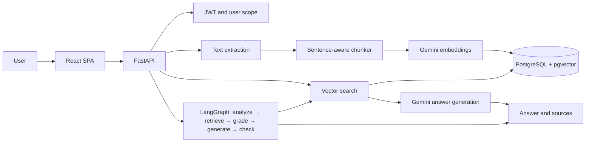

# DocMind AI

DocMind AI is a personal assistant for finding answers in uploaded documents. The
API accepts PDF, DOCX and TXT files, extracts the text, splits it into chunks,
gets Gemini embeddings and stores them in PostgreSQL with pgvector. A user can ask
a question, get an answer with references to the source chunks and inspect the
agent's workflow.

## Features

- Registration and JWT login; documents and search are isolated per user.
- Semantic search and plain RAG via `POST /rag/ask`.
- Agentic RAG via `POST /rag/agent`: question analysis, multiple search
  formulations, chunk grading and a check that the answer is grounded in the
  sources.
- Upload of PDF/DOCX/TXT up to 10 MiB, format validation, deduplication, listing,
  status and deletion of documents.
- React SPA with a chat, sources and an expandable agent trace.

## Architecture



More details: [architecture](docs/ARCHITECTURE.md), [evaluation](docs/EVALUATION.md).

## Quick start with Docker

You need Docker Engine and Docker Compose. Create a local env file and set unique
secrets:

```bash
cp .env.example .env
```

Replace `POSTGRES_PASSWORD`, `GEMINI_API_KEY`, `GEMINI_LLM_MODEL` and
`JWT_SECRET_KEY`. The JWT key must be random and stored only in `.env`.
Then start the application:

```bash
docker compose up --build
```

The `migrate` service applies Alembic migrations once the database is ready and
before the API starts. The UI will be available at <http://localhost:3000>, the
API docs at <http://localhost:3000/api/docs>, liveness at
<http://localhost:3000/api/health> and readiness at
<http://localhost:3000/api/ready>. PostgreSQL is published only on the loopback
port 5433.

To stop, use `docker compose down`. The database data stays in the
`postgres_data` volume; `docker compose down -v` deletes this volume together with
the data.

## Running the API locally

1. Create a virtual environment and install the pinned dependencies:

   ```bash
   python -m venv .venv
   # Windows PowerShell: .venv\Scripts\Activate.ps1
   # macOS/Linux: source .venv/bin/activate
   python -m pip install -r requirements.txt
   ```

2. Start PostgreSQL with pgvector (you can bring up just the `db` service with
   `docker compose up -d db`), copy `.env.example` to `.env` and configure
   `DATABASE_URL`, Gemini and JWT.
3. Apply the migrations and start the API:

   ```bash
   python -m alembic upgrade head
   uvicorn app.main:app --reload
   ```

4. For the UI, in a separate terminal:

   ```bash
   cd frontend
   npm ci
   npm run dev
   ```

   Vite proxies `/api/*` to the local API at `localhost:8000`.

## Environment variables

| Variable | Purpose |
|---|---|
| `DATABASE_URL` | SQLAlchemy URL, driver `postgresql+psycopg` |
| `POSTGRES_PASSWORD` | PostgreSQL password in Compose |
| `GEMINI_API_KEY` | Gemini key; do not commit it to Git |
| `GEMINI_EMBEDDING_MODEL` | Embedding model, `gemini-embedding-2` by default |
| `GEMINI_LLM_MODEL` | Generation model supported by your Gemini API |
| `JWT_SECRET_KEY` | Random secret for signing access tokens |
| `JWT_ALGORITHM` | JWT algorithm, `HS256` by default |
| `ACCESS_TOKEN_EXPIRE_MINUTES` | Access token lifetime |
| `CORS_ALLOWED_ORIGINS` | Comma-separated list of allowed origins; cross-origin is disabled by default |
| `TRUST_PROXY_HEADERS` | Accept the client IP from `X-Forwarded-For`; enable only behind a trusted reverse proxy |

Gemini calls have a 30-second timeout and up to three attempts for transient
errors. Rate limits for `/auth/*` and `/rag/*` are kept in the memory of a single
process; with several workers each process keeps its own counter.

## API

All document and RAG requests require `Authorization: Bearer <token>`.

| Method and path | Purpose |
|---|---|
| `POST /auth/register` | Create a user |
| `POST /auth/login` | Get a JWT; the same error for an unknown email and a wrong password |
| `POST /documents` | Upload a document as the multipart field `file` |
| `GET /documents?offset=0&limit=20` | A page of the document list with chunk counts |
| `GET /documents/{document_id}` | Status of a single document |
| `DELETE /documents/{document_id}` | Delete a document and its chunks |
| `POST /documents/search` | Find similar chunks |
| `POST /rag/ask` | Plain RAG; the response contract is unchanged |
| `POST /rag/agent` | Agentic RAG with `outcome` and `trace` |
| `GET /health` | Liveness without a database check |
| `GET /ready` | Readiness with a PostgreSQL check |

For `/rag/ask`, `/rag/agent` and search, send JSON like
`{"question":"..."}` (for search: `{"query":"..."}`).

## Checks and evaluation

Run the offline tests:

```bash
python -m pytest tests -v
ruff check app tests evaluation
```

GitHub Actions runs pytest, Ruff, Semgrep, pip-audit and builds both Docker
images. The agent unit tests use stubs and do not call Gemini.

Retrieval and RAG comparison results are collected in
[evaluation/RESULTS.md](evaluation/RESULTS.md). The sentence-aware 600/120
configuration was adopted: Precision@1 0.871, MRR 0.925, nDCG@5 0.946 on 31
questions. The hybrid FTS + RRF experiment gave Precision@1 0.774, MRR 0.887 and
nDCG@5 0.917, so it was rejected and is not wired into the API.

A new comparison of the baseline and the agent needs a running database, the
`eval@example.com` user, documents indexed from the locally ignored
`data/eval_docs/` folder and a valid Gemini API key:

```bash
python -m evaluation.agent_runner
```

The report will appear in `evaluation/reports/agent_vs_baseline.json`. Without an
external database and a Gemini key these metrics are not simulated; at the time of
this check the live run has not been performed because the database was
unavailable.

## Limitations and future work

- The current answer evaluation by `expected_facts` checks for an exact string
  match; a correct paraphrase may not be counted by the metric.
- The in-memory rate limiter is not synchronized between processes.
- Live integration checks require Gemini and PostgreSQL; only the offline tests
  and the frontend build were verified locally.
- Next steps: a distributed rate limiter, a stronger evaluation of the semantic
  accuracy of answers, and reranking after a separate comparison on the corpus.
