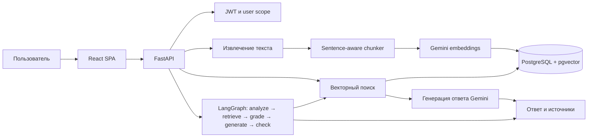

# DocMind AI

DocMind AI — личный помощник для поиска ответов в загруженных документах. API
принимает PDF, DOCX и TXT, извлекает текст, делит его на фрагменты, получает
эмбеддинги Gemini и хранит их в PostgreSQL с pgvector. Пользователь может задать
вопрос, получить ответ со ссылками на исходные фрагменты и посмотреть ход работы
агента.

## Возможности

- Регистрация и JWT-вход; документы и поиск изолированы по пользователю.
- Семантический поиск и обычный RAG через `POST /rag/ask`.
- Agentic RAG через `POST /rag/agent`: анализ вопроса, несколько поисковых
  формулировок, оценка фрагментов и проверка опоры ответа на источники.
- Загрузка PDF/DOCX/TXT до 10 MiB, проверка формата, дедупликация, список,
  состояние и удаление документов.
- React SPA с чатом, источниками и раскрываемым trace агента.

## Архитектура



Подробнее: [архитектура](docs/ARCHITECTURE.md), [оценка](docs/EVALUATION.md).

## Быстрый запуск в Docker

Нужны Docker Engine и Docker Compose. Создайте локальный env-файл и задайте
уникальные секреты:

```bash
cp .env.example .env
```

Замените `POSTGRES_PASSWORD`, `GEMINI_API_KEY`, `GEMINI_LLM_MODEL` и
`JWT_SECRET_KEY`. Ключ JWT должен быть случайным и храниться только в `.env`.
Затем запустите приложение:

```bash
docker compose up --build
```

Сервис `migrate` применит Alembic-миграции после готовности базы и до запуска
API. Интерфейс будет доступен на <http://localhost:3000>, документация API —
<http://localhost:3000/api/docs>, liveness — <http://localhost:3000/api/health>,
readiness — <http://localhost:3000/api/ready>. PostgreSQL публикуется только на
loopback-порту 5433.

Для остановки используйте `docker compose down`. Данные базы остаются в volume
`postgres_data`; `docker compose down -v` удалит этот volume вместе с данными.

## Локальный запуск API

1. Создайте виртуальное окружение и установите закреплённые зависимости:

   ```bash
   python -m venv .venv
   # Windows PowerShell: .venv\Scripts\Activate.ps1
   # macOS/Linux: source .venv/bin/activate
   python -m pip install -r requirements.txt
   ```

2. Запустите PostgreSQL с pgvector (можно поднять только сервис `db` через
   `docker compose up -d db`), скопируйте `.env.example` в `.env` и настройте
   `DATABASE_URL`, Gemini и JWT.
3. Примените миграции и запустите API:

   ```bash
   python -m alembic upgrade head
   uvicorn app.main:app --reload
   ```

4. Для интерфейса в отдельном терминале:

   ```bash
   cd frontend
   npm ci
   npm run dev
   ```

   Vite направляет `/api/*` на локальный API `localhost:8000`.

## Переменные окружения

| Переменная | Назначение |
|---|---|
| `DATABASE_URL` | SQLAlchemy URL, драйвер `postgresql+psycopg` |
| `POSTGRES_PASSWORD` | Пароль PostgreSQL в Compose |
| `GEMINI_API_KEY` | Ключ Gemini; не добавляйте его в Git |
| `GEMINI_EMBEDDING_MODEL` | Модель эмбеддингов, по умолчанию `gemini-embedding-2` |
| `GEMINI_LLM_MODEL` | Модель генерации, поддерживаемая вашим Gemini API |
| `JWT_SECRET_KEY` | Случайный секрет подписи access-токенов |
| `JWT_ALGORITHM` | Алгоритм JWT, по умолчанию `HS256` |
| `ACCESS_TOKEN_EXPIRE_MINUTES` | Срок действия access-токена |
| `CORS_ALLOWED_ORIGINS` | Список разрешённых origins через запятую; по умолчанию cross-origin отключён |
| `TRUST_PROXY_HEADERS` | Принимать IP клиента из `X-Forwarded-For`; включать только за доверенным reverse proxy |

Gemini-вызовы имеют таймаут 30 секунд и до трёх попыток для временных ошибок.
Ограничения частоты запросов `/auth/*` и `/rag/*` хранятся в памяти одного
процесса; при нескольких workers каждый процесс ведёт собственный счётчик.

## API

Все документы и RAG-запросы требуют `Authorization: Bearer <token>`.

| Метод и путь | Назначение |
|---|---|
| `POST /auth/register` | Создать пользователя |
| `POST /auth/login` | Получить JWT; одинаковая ошибка для неизвестного email и неверного пароля |
| `POST /documents` | Загрузить документ как multipart-поле `file` |
| `GET /documents?offset=0&limit=20` | Страница списка документов и число фрагментов |
| `GET /documents/{document_id}` | Состояние одного документа |
| `DELETE /documents/{document_id}` | Удалить документ и связанные фрагменты |
| `POST /documents/search` | Найти похожие фрагменты |
| `POST /rag/ask` | Обычный RAG; контракт ответа сохранён |
| `POST /rag/agent` | Agentic RAG с `outcome` и `trace` |
| `GET /health` | Liveness без проверки базы |
| `GET /ready` | Готовность с проверкой PostgreSQL |

Для `/rag/ask`, `/rag/agent` и поиска передавайте JSON вида
`{"question":"..."}` (для поиска — `{"query":"..."}`).

## Проверки и оценка

Запуск offline-тестов:

```bash
python -m pytest tests -v
ruff check app tests evaluation
```

GitHub Actions запускает pytest, Ruff, Semgrep, pip-audit и сборки обоих Docker
образов. Unit-тесты агента используют заглушки и не обращаются к Gemini.

Результаты поиска и сравнения RAG собраны в
[evaluation/RESULTS.md](evaluation/RESULTS.md). Sentence-aware конфигурация
600/120 принята: Precision@1 0.871, MRR 0.925, nDCG@5 0.946 на 31 вопросе.
Hybrid FTS + RRF эксперимент дал Precision@1 0.774, MRR 0.887 и nDCG@5 0.917,
поэтому он отклонён и не подключён к API.

Для нового сравнения baseline и агента нужны запущенная БД, пользователь
`eval@example.com`, индексированные документы из локальной игнорируемой папки
`data/eval_docs/` и действующий Gemini API key:

```bash
python -m evaluation.agent_runner
```

Отчёт появится в `evaluation/reports/agent_vs_baseline.json`. Без внешней БД и
Gemini-ключа эти метрики не моделируются; на момент текущей проверки live-прогон
не выполнен, потому что база недоступна.

## Ограничения и дальнейшая работа

- Текущая оценка ответа по `expected_facts` проверяет точное вхождение строки;
  корректная перефразировка может не попасть в метрику.
- In-memory rate limiter не синхронизируется между процессами.
- Живые интеграционные проверки требуют Gemini и PostgreSQL; локально проверены
  offline-тесты и сборка frontend.
- Дальнейшие направления: распределённый rate limiter, более сильная оценка
  семантической точности ответов и reranking после отдельного сравнения на корпусе.
