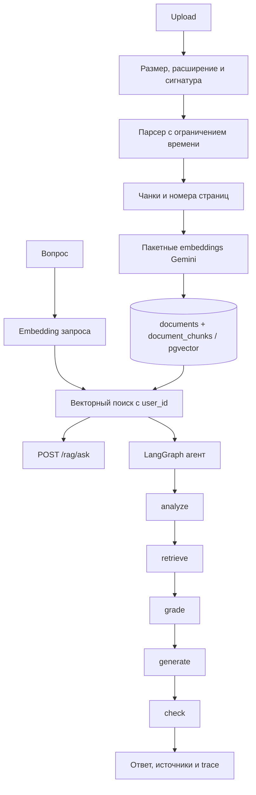

# Архитектура DocMind AI

## Компоненты

- **FastAPI** предоставляет регистрацию, JWT-вход, загрузку и управление
  документами, поиск и два варианта RAG.
- **SQLAlchemy 2 async** и psycopg работают с PostgreSQL; pgvector хранит
  векторы размерности 768. Alembic управляет схемой.
- **Парсер** извлекает страницы PDF, структуру DOCX или UTF-8 текст.
- **Chunker** сохраняет границы предложений и метаданные страницы.
- **Gemini** создаёт embeddings пакетами при загрузке и генерирует ответы.
- **LangGraph** реализует agentic pipeline; каждый поисковый запрос ограничен
  авторизованным `user_id`.
- **React + TypeScript** хранит access token только в `sessionStorage` и общается
  с API через относительный `/api`.

## Поток документа и вопроса

Документ дедуплицируется по SHA-256 от `user_id + содержимое`; уникальное
ограничение в БД закрывает гонку параллельных загрузок. Удаление документа
каскадно удаляет его чанки.

## Надёжность и границы

- `/health` проверяет, что процесс отвечает; `/ready` проверяет соединение с БД.
- Middleware добавляет/проверяет `X-Request-ID`, пишет JSON-лог с методом,
  путём, статусом и временем ответа, ограничивает частоту auth/RAG и размер
  запроса по `Content-Length`.
- Gemini SDK ограничивает запрос 30 секундами и делает максимум три попытки на
  временных HTTP-ошибках.
- Агент не выполняет инструкции из содержимого passages. Ошибка генерации агента
  превращается в отказ с trace; ошибка grader/checker использует описанную в
  тестах fail-open политику.
- Rate limiter хранит счётчики в памяти процесса. За reverse proxy несколько
  workers не разделяют лимиты; для горизонтального масштабирования нужен общий
  backend лимитера и доверенная настройка IP клиента.
